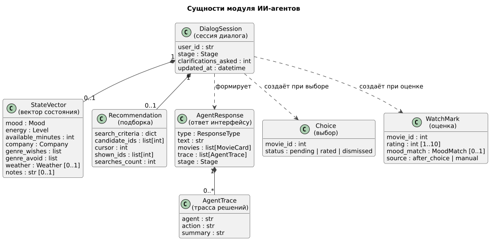
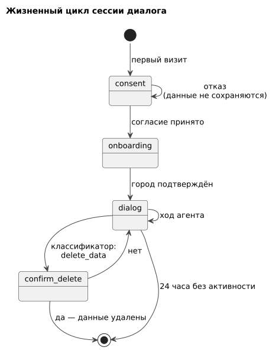

# 050 — Entities + Lifecycle

*CineMatch. Модуль ИИ-агентов* | [оглавление модуля](README.md)

Модуль агентов создаёт и использует сущности ниже; физически их хранит модуль данных ([120 Data Model модуля данных](../data/120.data-model.md)). Атрибуты и типы определены в [общем контракте](../overall/contracts.md#2-модели) и здесь не дублируются.

| Сущность | Роль в модуле | Ограничения | Определение |
|---|---|---|---|
| DialogSession | состояние диалога | одна на пользователя; 24 ч без активности; `messages` ≤ 20; `shown_ids` ≤ 50 | [contracts §2.5](../overall/contracts.md#25-sessionstate--состояние-диалога) |
| EveningContext | результат `extract_context` | значения из перечней; `null` — не сказано | [contracts §2.4](../overall/contracts.md#24-eveningcontext--контекст-вечера) |
| AgentOutput | ответ агента | `movie_ids` 0–3; ровно 3, если поиск вернул не меньше трёх; `reasons` той же длины | [contracts §2.6](../overall/contracts.md#26-agentoutput--структурированный-ответ-агента) |
| AgentTrace | шаг трассы | без промптов, ключей и `user_id` | [contracts §2.7](../overall/contracts.md#27-agenttrace--шаг-трассы) |
| AgentResponse | ответ API-слою | проверяется по схеме перед отдачей | [contracts §2.3](../overall/contracts.md#23-agentresponse--ответ-модуля-агентов-api-слою) |
| Choice | выбор фильма | не более одного `pending` на пользователя | [120 данных](../data/120.data-model.md) |
| WatchMark (оценка) | оценка 1–10 | одна на фильм; повторная заменяет прежнюю | [120 данных](../data/120.data-model.md) |

## 1. Жизненный цикл сессии

Этапы задают инварианты, которые проверяет код. Внутри этапа `dialog` ход разговора определяет агент.

| Этап | Описание | Переход |
|---|---|---|
| `consent` | Показ правил хранения данных | согласие кнопкой (`POST /api/v1/consent`) или текстом (`parse_consent` вернул `yes`) → `onboarding`; отказ — этап сохраняется, данные не записываются |
| `onboarding` | Пользователь называет город | город найден и подтверждён → `dialog`; не найден — этап сохраняется |
| `dialog` | Разговор с агентом: подбор, реакции, оценки | классификатор вернул `delete_data` → `confirm_delete` |
| `confirm_delete` | Ожидание подтверждения удаления | `yes` → данные удалены, следующий визит начинается с `consent`; `no` → `dialog`; невалидно дважды → `dialog` |

`/start` этап не меняет: это точка входа, которая возвращает приветствие текущего этапа ([146 §3](146.logic-scheme.md#3-служебное-сообщение-start)).

## 2. Неоценённый выбор

`pending` — кэш; источник истины — таблица выборов со статусом `pending`.

1. При `/start` на этапе `dialog` оркестратор вызывает `get_pending_feedback(user_id)` и передаёт агенту вопрос об оценке.
2. Выбор закрывается оценкой (`save_rating`) или отказом «не смотрел» (`close_choice`).
3. Если пользователь не вернулся за 24 ч, сессия истекает, но выбор остаётся в базе и будет предложен при следующем визите.
4. Восстановление сессии — [120 §3](120.data-model.md#3-сессия-и-восстановление).

## 3. Удаление данных

Удаляются: согласие и настройки пользователя, сессии, выборы, оценки. Трасса и подборки не хранятся отдельно от сессии, поэтому удаляются вместе с ней. Журнал хранит только обезличенные события (`UserDataDeleted` с `deleted_counts`), текст сообщений в журнал не пишется.

## 4. Будущий функционал

Сущности `Reminder` и `Subscription` для агента-планировщика.

---

[← 040 Event Storming](040.event-storming.md) | [Оглавление](README.md) | [060 Use Cases →](060.use-cases.md)
