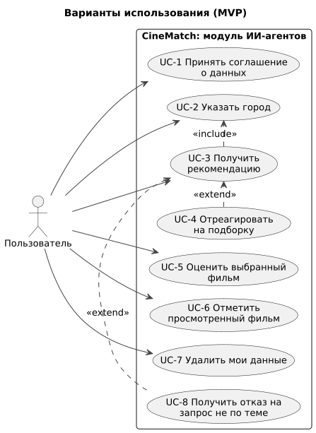
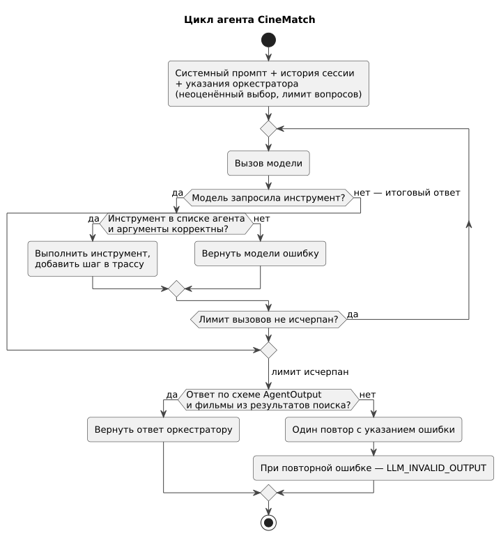

# 060 — Use Cases

*CineMatch. Модуль ИИ-агентов* | [оглавление модуля](README.md)

Нумерация вариантов использования сквозная по проекту: UC-1…UC-8 — модуль агентов, UC-9 — [модуль данных](../data/060.use-cases.md), UC-10…UC-12 — [модуль интерфейса](../ui/060.use-cases.md).

| ID | Вариант использования | Актор | Исполнитель |
|---|---|---|---|
| UC-1 | Принять соглашение о данных | Пользователь | Оркестратор |
| UC-2 | Указать город | Пользователь | Оркестратор |
| UC-3 | Получить рекомендацию | Пользователь | Агент |
| UC-4 | Отреагировать на подборку | Пользователь | Агент |
| UC-5 | Оценить выбранный фильм | Пользователь | Агент |
| UC-6 | Отметить просмотренный фильм | Пользователь | Агент |
| UC-7 | Удалить мои данные | Пользователь | Классификатор, оркестратор |
| UC-8 | Получить отказ на запрос не по теме | Пользователь | Классификатор, оркестратор |

#### UC-1. Принять соглашение о данных

| | |
|---|---|
| Предусловия | Пользователь открыл приложение первый раз или удалил данные |
| Постусловия | `users.consent_at` заполнен, этап `onboarding`; при отказе — ничего не сохранено |
| Основной поток | 1. `GET /api/v1/session` показывает `consent: false`. 2. API-слой отправляет `/start`; оркестратор отвечает `type=consent` с текстом правил ([110 §2](110.ui-ux.md#2-текст-согласия)). 3. Пользователь нажимает «Принимаю» → `POST /api/v1/consent {"accepted": true}` → `set_consent(user_id, True)`. 4. Оркестратор сохраняет `consent_at`, переводит этап в `onboarding` и возвращает просьбу назвать город |
| Альтернативы | 3а. Пользователь пишет «принимаю» в чат: локальный разбор `parse_consent` вернул `yes` → та же функция; модель не вызывается. 3б. «Не сейчас» или «нет» → `set_consent(user_id, False)`: правила показываются снова, ничего не сохраняется, модель не вызывается. 3в. Любое другое сообщение на этапе `consent` — `parse_consent` вернул `no`, правила показываются снова |
| Истории | US-01 |

#### UC-2. Указать город

| | |
|---|---|
| Предусловия | Согласие принято, этап `onboarding` |
| Постусловия | Город и координаты сохранены, этап `dialog` |
| Основной поток | 1. Пользователь пишет название. 2. Оркестратор вызывает `resolve_city(name)` → до 5 вариантов. 3. Один вариант — `save_user_settings(user_id, city, latitude, longitude)`, этап `dialog`, приветствие. 4. Несколько — ответ `question` со списком «название, регион, страна»; выбор сохраняется следующим сообщением |
| Альтернативы | 2а. Ноль вариантов — `CITY_NOT_FOUND` с текстом из [contracts §6](../overall/contracts.md#6-ошибки), этап не меняется. 4а. Пользователь называет город заново — поиск повторяется. Модель на этапе не вызывается |
| Истории | US-02 |

#### UC-3. Получить рекомендацию

| | |
|---|---|
| Предусловия | Согласие принято, город указан, этап `dialog` |
| Постусловия | Показано от одного до трёх фильмов с объяснением и трассой; показанные записаны в сессию |
| Основной поток | 1. Пользователь пишет запрос в свободной форме. 2. Классификатор относит его к `cinema`. 3. Агент вызывает `extract_context` и получает контекст вечера. 4. Если не хватает времени или компании, агент задаёт вопрос (не более двух за подбор). 5. Агент запрашивает погоду, профиль и последние оценки. 6. Агент выбирает критерии по правилам [120 §2](120.data-model.md#2-правила-контекст--критерии-поиска) и вызывает `find_movies`. 7. Агент выбирает до трёх фильмов из найденных и объясняет выбор. 8. Оркестратор проверяет, что фильмы есть в результатах поиска, склеивает карточки и отдаёт подборку с постерами и возрастной маркировкой |
| Альтернативы | 5а. Погода недоступна — подбор без неё. 6а. Найдено меньше трёх — ослабление критериев ([120 §2.1](120.data-model.md#21-ослабление-критериев)), не больше двух; ноль — ответ без карточек с предложением изменить пожелания. 6б. `genres` пуст — поиск без жанрового фильтра. 8а. Фильм не из результатов поиска — один повтор, затем `LLM_INVALID_OUTPUT`. 8б. Ошибка модели — один повтор, затем `LLM_UNAVAILABLE` |
| Истории | US-03, US-04, US-05 |

#### UC-4. Отреагировать на подборку

| | |
|---|---|
| Предусловия | Подборка показана |
| Постусловия | Фильм выбран, показаны другие варианты или подбор завершён |
| Основной поток | 1. Пользователь пишет ответ или нажимает на карточку (интерфейс отправляет «Выбираю «…»» с подсказкой `movie_id`). 2. Агент определяет реакцию. 3а. Выбор — агент вызывает `save_choice(movie_id)`. 3б. Другие варианты — агент вызывает `find_movies` с прежними или изменёнными критериями; показанные исключаются кодом через `exclude_ids`. 3в. Отказ — агент завершает подбор коротким сообщением |
| Альтернативы | 2а. Реакция неоднозначна — один уточняющий вопрос. 3а-1. `save_choice` с фильмом не из последней подборки — `NOT_FOUND` модели, агент уточняет выбор. 3б-1. Новых фильмов нет — ответ «больше ничего не нашлось» с предложением изменить критерии |
| Истории | US-06, US-07, US-08 |

#### UC-5. Оценить выбранный фильм

| | |
|---|---|
| Предусловия | Есть выбор со статусом `pending`; пользователь открыл приложение |
| Постусловия | Оценка сохранена, выбор закрыт |
| Основной поток | 1. `/start` находит неоценённый выбор (`get_pending_feedback`) и возвращает `feedback_question`. 2. Агент спрашивает оценку от 1 до 10 и подошёл ли фильм под настроение. 3. Агент вызывает `save_rating(movie_id, rating, source="after_choice", mood_match=…)` |
| Альтернативы | 2а. «Не смотрел» — `close_choice(status="dismissed")`. 2б. Пользователь сразу пишет о другом или просит новый фильм — новый запрос выполняется, оценка откладывается до следующего `/start`, `pending` сохраняется. 2в. Оценка вне 1–10 — `INVALID_PARAM`, один уточняющий вопрос |
| Истории | US-09 |

#### UC-6. Отметить просмотренный фильм

| | |
|---|---|
| Предусловия | Этап `dialog` |
| Постусловия | Оценка сохранена с источником `manual`; фильм больше не рекомендуется |
| Основной поток | 1. Пользователь пишет «посмотрел X, на 7». 2. Агент вызывает `search_movie(title, year)`. 3. Одно совпадение — `save_rating(..., source="manual")`; агент подтверждает названием и годом |
| Альтернативы | 2а. Несколько совпадений — уточняющий вопрос с годами. 2б. Не найдено — просьба уточнить название. 1а. Оценка не указана — один вопрос об оценке |
| Истории | US-10 |

#### UC-7. Удалить мои данные

| | |
|---|---|
| Предусловия | Согласие принято, этап `dialog` |
| Постусловия | Все данные пользователя удалены; следующий визит начинается с `consent` |
| Основной поток | 1. Пользователь пишет просьбу удалить данные. 2. Классификатор вернул `delete_data`; оркестратор переводит сессию в `confirm_delete` и спрашивает подтверждение. 3. Классификатор этапа `confirm_delete` вернул `yes`. 4. Оркестратор вызывает `delete_user_data(user_id)`, очищает сессию, отвечает «Готово, данные удалены.» |
| Альтернативы | 3а. `no` — этап `dialog`, данные сохраняются. 3б. Вопрос «что удалится?» — этап сохраняется, показывается пояснение, классификатор не вызывается. 3в. Невалидный ответ дважды — этап `dialog`, удаление отменено. 1а. Пользователь ушёл на этапе подтверждения — сессия истекает, удаление не выполняется |
| Истории | US-11 |

#### UC-8. Получить отказ на запрос не по теме

| | |
|---|---|
| Предусловия | Любой этап после согласия |
| Постусловия | Пользователь получил отказ, агент не вызывался, данные не изменились |
| Основной поток | 1. Пользователь пишет запрос не по теме или небезопасный. 2. Классификатор вернул `off_topic` или `unsafe`. 3. Оркестратор возвращает `type=message` с текстом из [110 §5](110.ui-ux.md#5-тексты-диалога), событие `OffTopicRejected` в журнал |
| Альтернативы | 2а. Классификатор ошибся дважды — безопасное поведение: агент не вызывается, отказ по теме. 2б. Сообщение похоже на кино — выбирается `cinema`, чтобы не терять запрос |
| Истории | US-12 |

Служебное сообщение `/start` не является вариантом использования: это контракт API-слоя и оркестратора ([146 §3](146.logic-scheme.md#3-служебное-сообщение-start)).

### Будущий функционал

| ID | Вариант использования |
|---|---|
| UC-F1 | Создать напоминание фразой («в пятницу в 20:00 выбрать кино») |
| UC-F2 | Подписаться на сериал или премьеру |
| UC-F3 | Получить подборку новинок по вкусу |
| UC-F4 | Выбрать фильм для компании |

---

[← 050 Entities + Lifecycle](050.entities.md) | [Оглавление](README.md) | [070 RBAC →](070.role-matrix.md)
