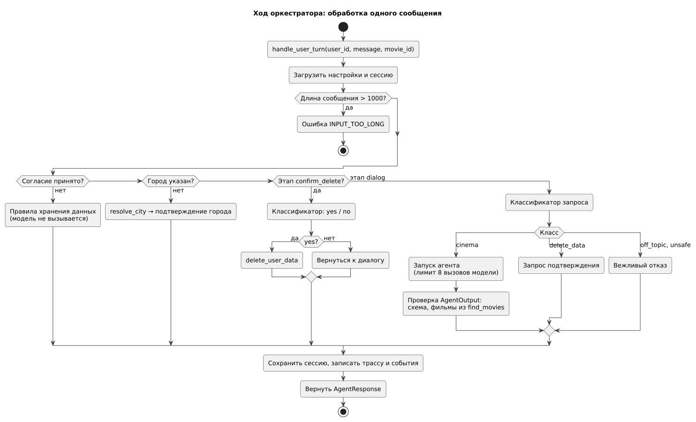
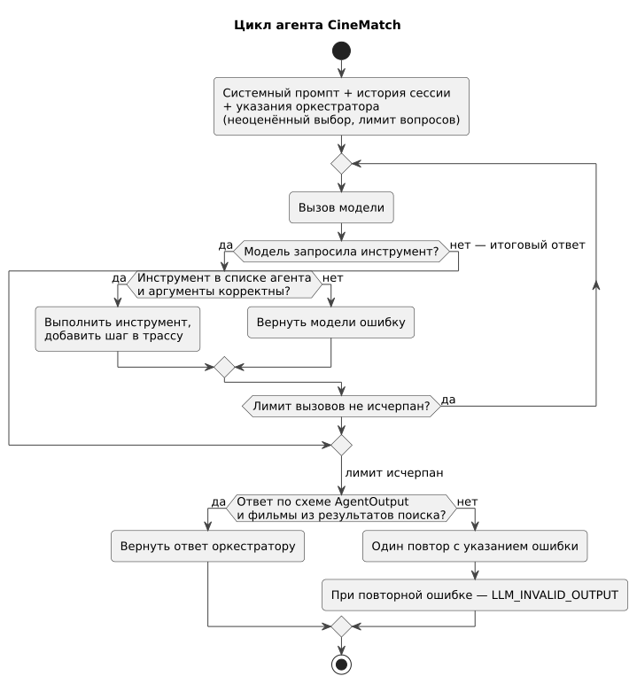

# 146 — Logic Scheme

*CineMatch. Модуль ИИ-агентов* | [оглавление модуля](README.md)

Документ описывает ход обработки сообщения текстом и псевдокодом; диаграммы ниже — его иллюстрация. Контракты структур и пределы — [overall/contracts.md](../overall/contracts.md).

**Ход оркестратора: обработка одного сообщения**



**Цикл агента**



## 1. Порядок шагов

| № | Шаг | Что проверяется | Результат |
|---|---|---|---|
| 1 | Приём сообщения | текст не пуст, ≤ 1000 символов | иначе `INVALID_INPUT` / `INPUT_TOO_LONG` |
| 2 | Загрузка пользователя и сессии | согласие, город, этап, срок сессии | этап и `SessionState` (восстановление — [120 §3](120.data-model.md#3-сессия-и-восстановление)) |
| 3 | `/start` | точное совпадение | приветствие этапа, выход без модели |
| 4 | Инварианты этапа | `consent`, `onboarding`, `confirm_delete` | действие этапа или переход к диалогу |
| 5 | Проверка каталога | `get_catalog_size() == 0` на этапе `dialog` | `CATALOG_EMPTY` без классификатора и агента; `DATA_UNAVAILABLE` при отказе базы |
| 6 | Классификатор | промпт `classifier.md` на этапе `dialog` | `cinema` / `delete_data` / `off_topic` / `unsafe` |
| 7 | Ветвление | класс запроса | вызов агента или отказ без модели |
| 8 | Агент | цикл вызовов модели и инструментов | `AgentOutput` и трасса |
| 9 | Проверка ответа | схема, фильмы из поиска, длины, число фильмов, `genre_avoid`, время | подборка или повтор/ошибка |
| 10 | Сборка ответа | склейка карточек, трасса, этап | `AgentResponse` |
| 11 | Сохранение | сессия, история, события | журнал |

## 2. Псевдокод

```python
async def handle_user_turn(user_id, message, movie_id=None, on_progress=None):
    progress = on_progress or (lambda step, text: None)

    if not message.strip():
        return error("INVALID_INPUT")
    if len(message) > 1000:
        return error("INPUT_TOO_LONG")
    if not try_acquire_turn(user_id):
        return error("SESSION_BUSY")

    user = get_user(user_id)
    session = load_or_restore_session(user)      # 120 §3
    progress("classify", "Определяю, что вы написали…")

    if message == "/start":
        return start_response(user, session)      # §3 этого документа

    if session.stage == "consent":
        answer = parse_consent(message)            # yes / no, локально, без модели
        if answer == "yes":
            return await set_consent(user_id, True)
        return consent_response(again=True)

    if session.stage == "onboarding":
        return onboarding_turn(user, session, message)   # §5

    if session.stage == "confirm_delete":
        if looks_like_question(message):
            return confirmation(DELETE_HELP_TEXT)          # §7, этап не меняется
        cls = classify(message, stage="confirm_delete")
        return delete_turn(user_id, session, confirmed=(cls == "yes"))

    # stage == "dialog"
    if get_catalog_size() == 0:
        return error("CATALOG_EMPTY")

    cls = classify(message, stage="dialog")       # cinema / delete_data / off_topic / unsafe
    if cls == "delete_data":
        session.stage = "confirm_delete"
        save(session)
        return confirmation("Удалить оценки, историю и настройки? …")
    if cls in ("off_topic", "unsafe"):
        log("OffTopicRejected", cls=cls)
        return message_response(OFF_TOPIC_TEXT)

    output, trace, context = run_agent(user, session, message, movie_id, progress)
    session.context = merge_context(session.context, context)   # 120 §2.0
    movies = validate(output, trace)              # 120 §5
    session = update_session(session, output, movies)
    save(session)
    return AgentResponse(type=type_of(output), text=output.text,
                         movies=movies, trace=trace, stage=session.stage)
```

Весь ход после проверки длины выполняется под блокировкой пользователя; в псевдокоде `try/finally` опущен, снятие — в `finally` (см. §9).

`type_of` — отображение из [contracts §2.3](../overall/contracts.md#23-agentresponse--ответ-модуля-агентов-api-слою): `question`→`question`, `recommendations`→`recommendations`, `feedback_question`→`feedback_question`, `confirmation`→`confirmation`, `message`→`message`. Типы `consent` и `error` формирует только оркестратор.

## 3. Служебное сообщение `/start`

1. API-слой отправляет `/start` при открытии страницы после `GET /api/v1/session`.
2. Оркестратор обрабатывает его до классификатора, до загрузки промптов агента и до вызова модели.
3. В `messages` и `shown_ids` сообщение не попадает; трасса пуста.
4. Ответ зависит от этапа:

| Этап | `type` | Содержание ответа |
|---|---|---|
| `consent` | `consent` | правила хранения данных и две кнопки: «Принимаю» / «Не сейчас» |
| `onboarding` | `question` | приветствие и просьба назвать город; если есть `city_options` — список вариантов |
| `dialog` | `message` | приветствие; если есть неоценённый выбор — `feedback_question` с вопросом об оценке |
| `confirm_delete` | `confirmation` | напоминание о подтверждении удаления |

5. Других служебных команд нет. Сообщение, начинающееся с `/`, кроме точного `/start`, идёт обычным путём и, как правило, классифицируется как `off_topic`.

## 4. Согласие

```python
async def set_consent(user_id: str, accepted: bool) -> AgentResponse:
    if accepted:
        save_consent(user_id, source="web")
        state = new_session(stage="onboarding")
        save_session_state(user_id, state)
        return question(CITY_PROMPT)
    return consent_response(again=True)   # ничего не сохраняется
```

Вызовы: `POST /api/v1/consent {"accepted": true}` из интерфейса и текст на этапе `consent`. Текст разбирает `parse_consent(message)` — локальная функция без модели: `yes` для «да», «принимаю», «согласен/согласна», «конечно», «ок»; `no` для «нет», «не сейчас», «отказываюсь», «не принимаю»; всё остальное — `no`. Модель к согласию не допускается.

## 5. Этап `onboarding`: город

1. Если в `SessionState.city_options` уже есть варианты, оркестратор сначала пытается сопоставить ответ с ними: номер («первый», «2»), название, «название, регион». Совпадение — `save_user_settings`, этап `dialog`, `city_options = []`.
2. Если ответ не сопоставлен, вызывается `resolve_city(message)`: до 5 вариантов.
3. Один вариант — оркестратор сохраняет его через `save_user_settings`, переводит этап в `dialog`, ответ — приветствие и первый вопрос агента.
4. Несколько вариантов — ответ `question` со списком «название, регион, страна», варианты сохраняются в `SessionState.city_options`; выбор принимается следующим сообщением.
5. Ноль вариантов — `AgentResponse(type="error", error_code="CITY_NOT_FOUND")` с текстом из [contracts §6](../overall/contracts.md#6-ошибки). Этап и `city_options` не меняются.
6. Модель на этом этапе не вызывается.

## 6. Этап `dialog`: агент

1. Перед вызовом агента оркестратор передаёт только `user_id`, историю `messages`, накопленный `context`, `today`, `city`, `questions_left`, `pending_feedback` и список `{genres}` из `get_genres()` для промпта `extract_context`. Погоду, оценки и профиль агент получает инструментами `get_weather`, `get_user_ratings`, `get_user_profile`; отдельных плейсхолдеров для них нет.
2. Агент работает циклом: вызов модели → вызов инструмента → результат → снова модель. Не больше 8 вызовов модели за ход.
3. Перед каждым вызовом инструмента — `progress("tool", <фраза>)` из [110 §4](110.ui-ux.md#4-фразы-хода-работы).
4. Ответ модели — `AgentOutput` по схеме. Пустой или невалидный — один повтор с `retry_invalid_output.md`.
5. `extract_context` возвращает только факты текущего сообщения; оркестратор сливает их с `session.context` по правилам [120 §2.0](120.data-model.md#20-обновление-контекста).
6. Проверка ответа и сборка `AgentResponse` — [120 §5](120.data-model.md#5-проверка-ответа).
7. После ответа — `progress("check", "Проверяю подборку…")`.
8. Трассу строит код: шаг, `action` и `summary` берутся из вызова инструмента и его результата по таблице [contracts §2.7](../overall/contracts.md#27-agenttrace--шаг-трассы); модель их не пишет.

## 7. Этап `confirm_delete`

| Ответ | Действие | Ответ пользователю |
|---|---|---|
| `yes` | `delete_user_data(user_id)`, очистка сессии | «Готово, данные удалены.» |
| `no` | этап → `dialog`, ничего не удаляется | короткое подтверждение, диалог продолжается |
| вопрос («что удалится?», «какие данные?») | этап не меняется, классификатор не вызывается | «Удалятся оценки, история выборов, город и настройки. Каталог фильмов останется. Ответьте «да» или «нет».» |
| невалидно дважды | этап → `dialog`, данные сохраняются | отказ разобрать ответ, подтверждение отменено |

Вопрос определяется по наличию `?` или слов «что», «какие», «как» в сообщении; это локальная проверка, не модель.

## 8. События хода работы

| Момент | `step` | Пример `text` |
|---|---|---|
| сразу при приёме сообщения | `classify` | «Определяю, что вы написали…» |
| перед вызовом инструмента | `tool` | «Смотрю ваши оценки…», «Ищу фильмы…» |
| после ответа модели | `check` | «Проверяю подборку…» |

События формирует только оркестратор; API-слой перекладывает их в SSE ([ui/130](../ui/130.api-contracts.md)). Ошибка обработчика записывается в журнал и не прерывает ход.

## 9. Лимиты, тайм-ауты и блокировка

| Что | Значение | Поведение при превышении |
|---|---|---|
| Входное сообщение | 1000 символов | `INPUT_TOO_LONG` |
| Вызовов модели на сообщение | 8 | `LIMIT_EXCEEDED` |
| Запрос к RouterAI | `LLM_TIMEOUT_S` = 20 с | один повтор, затем `LLM_UNAVAILABLE` |
| Ход оркестратора | `TURN_TIMEOUT_S` = 45 с | `LIMIT_EXCEEDED` |
| Ожидание в API-слое | `AGENT_TIMEOUT_S` = 60 с | `AGENT_TIMEOUT` |

Значения и условие `LLM_TIMEOUT_S < TURN_TIMEOUT_S < AGENT_TIMEOUT_S` — [overall/config.md §2](../overall/config.md#2-тайм-ауты-и-целевые-значения).

**Один активный ход на пользователя.** Оркестратор держит `dict[user_id, asyncio.Lock]`; `handle_user_turn` пытается взять lock без ожидания и при занятом lock возвращает `AgentResponse(type="error", error_code="SESSION_BUSY")`. API-слой дополнительно проверяет тот же признак до открытия SSE и отвечает `409`. Lock снимается в `finally`, в том числе при `TURN_TIMEOUT_S`; при перезапуске процесса блокировки исчезают вместе с процессом. Второй запрос не перезаписывает сессию первого.

Цель 10 с (NFR-AG-01) — статистическая: 95 % сообщений. Верхняя граница хода — 45 с; восемь вызовов по 20 с — это аварийный предел, а не целевое время.

## 10. Журнал

На каждый ход пишутся: `event=turn`, `user_id`, `stage`, `class`, `tool_calls`, `model_calls`, `duration_ms`, `tokens_in`, `tokens_out`, `result` (тип ответа или код ошибки). Отдельные события — [135](135.event-catalog.md), схемы — [140](140.event-schema.md). Текст сообщения пользователя и системный промпт в журнал не попадают.

## 11. Будущий функционал

Асинхронная ветка для напоминаний: агент-планировщик создаёт запись, доставку выполняет бот.

---

[← 145 ADR](145.architecture-decisions.md) | [Оглавление](README.md) | [150 Component Diagram →](150.component-diagram.md)
