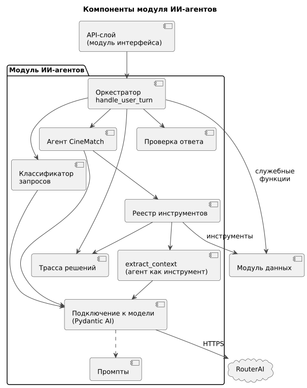

# 150 — Component Diagram

*CineMatch. Модуль ИИ-агентов* | [оглавление модуля](README.md)



| Компонент | Технология | Ответственность | Вход → выход |
|---|---|---|---|
| Оркестратор | Python | Этапы сессии, согласие, город, подтверждение удаления, лимиты, сборка `AgentResponse` | сообщение → `AgentResponse` |
| Классификатор запросов | Pydantic AI, structured output | Класс запроса из закрытого перечня; промпт зависит от этапа | текст, этап → `RequestClass` |
| Агент CineMatch | Pydantic AI, tool use | Ведение диалога, выбор инструментов, ответ по схеме `AgentOutput` | контекст, история → `AgentOutput` |
| Инструмент `extract_context` | Pydantic AI, structured output | Контекст вечера из текста пользователя | текст → `EveningContext` |
| Реестр инструментов | Python | Список инструментов, подстановка `user_id` и `exclude_ids`, проверка аргументов записи | имя инструмента, аргументы → результат или `ToolError` |
| Проверка ответа | Python, Pydantic | Схема, фильмы из результатов поиска, длины, число фильмов, один вопрос | `AgentOutput` → `RecommendedMovie[]` или ошибка |
| Клиент модели | Pydantic AI, OpenAI SDK | Запросы к RouterAI, повтор, тайм-аут, учёт токенов, лимит вызовов | сообщения → ответ модели |
| Загрузчик промптов | Python | Чтение файлов `prompts/`, проверка версии в шапке, кэш в памяти | путь → текст промпта |
| Прогресс и события | Python | Вызов `on_progress(step, text)` в точках, известных оркестратору | шаг → событие |
| Трасса решений | Python | Сбор шагов агента для ответа и журнала по таблице [contracts §2.7](../overall/contracts.md#27-agenttrace--шаг-трассы); маскирование служебных данных | вызовы → `AgentTrace[]` |
| Блокировка хода | Python, `asyncio.Lock` | Один активный ход на `user_id`; второй запрос получает `SESSION_BUSY`; снятие в `finally` | `user_id` → lock / `SESSION_BUSY` |
| Журнал | Python, JSON | Запись событий и метрик хода | событие → строка журнала |

## 1. Взаимодействие компонентов

```
API-слой
  └─ handle_user_turn ──► Оркестратор
                            ├─ Загрузчик промптов ──► prompts/*.md
                            ├─ Классификатор ──► Клиент модели
                            ├─ Агент ──┬─ Реестр инструментов ──► модуль данных
                            │          └─ Клиент модели ──► RouterAI
                            ├─ Проверка ответа
                            ├─ Прогресс ──► on_progress ──► SSE
                            ├─ Трасса
                            └─ Журнал
```

Правила:

1. Модуль данных вызывается только через реестр инструментов; прямых импортов его репозиториев в агенте нет.
2. Клиент модели — единственное место с ключом и тайм-аутом; он же считает вызовы (≤ 8) и токены.
2a. Блокировка хода — единственное место, где решается `SESSION_BUSY`; API-слой читает тот же признак, но не создаёт второй lock.
3. Проверка ответа не вызывает модель: она либо принимает, либо возвращает ошибку для одного повтора.
4. Прогресс не знает о SSE: он вызывает функцию, переданную API-слоем.

## 2. Пороги и лимиты в компонентах

| Компонент | Проверка | Значение |
|---|---|---|
| Оркестратор | длина входа | 1000 символов |
| Проверка ответа | длина текста | 1200 символов |
| Проверка ответа | длина объяснения | 240 символов |
| Проверка ответа | фильмов в подборке | 3 (меньше — только при нехватке результатов) |
| Клиент модели | вызовов на сообщение | 8 |
| Клиент модели | тайм-аут запроса | `LLM_TIMEOUT_S` |
| Оркестратор | тайм-аут хода | `TURN_TIMEOUT_S` |
| Блокировка хода | время жизни | `TURN_TIMEOUT_S`, снятие в `finally` |

Значения — [overall/config.md §2](../overall/config.md#2-тайм-ауты-и-целевые-значения), пределы — [overall/contracts.md §8](../overall/contracts.md#8-пределы).

## 3. Будущий функционал

Компонент «Агент-планировщик» с собственным набором инструментов.

---

[← 146 Logic Scheme](146.logic-scheme.md) | [Оглавление](README.md) | [155 Sequence-диаграммы →](155.sequence-diagrams.md)
