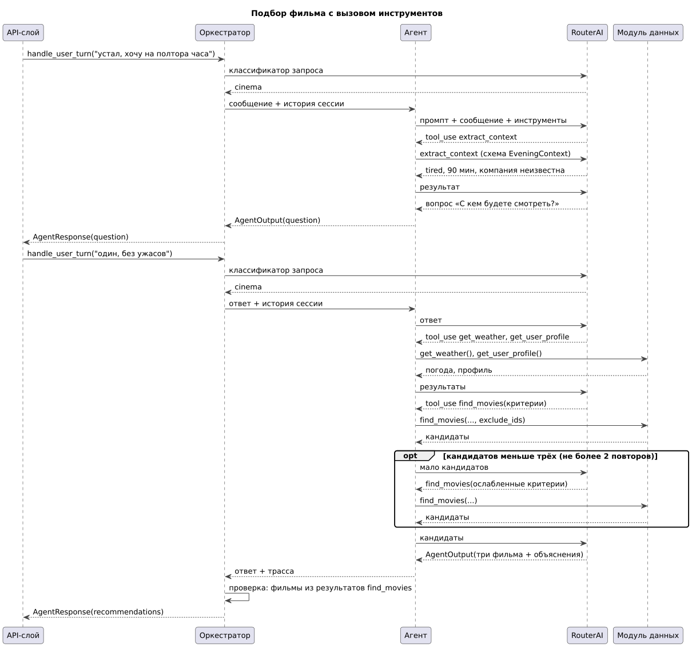
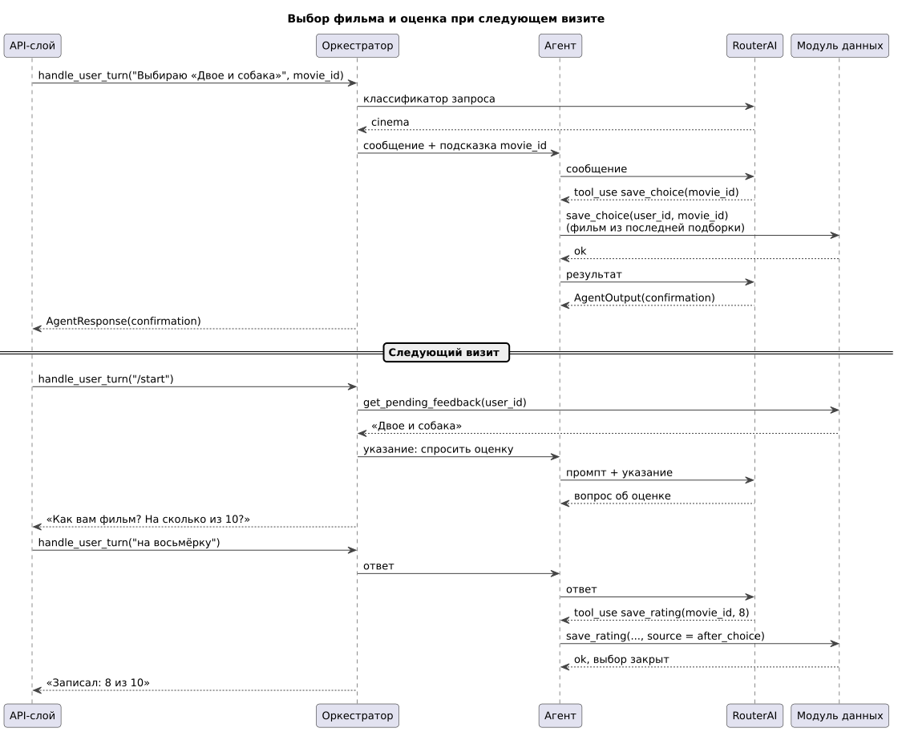
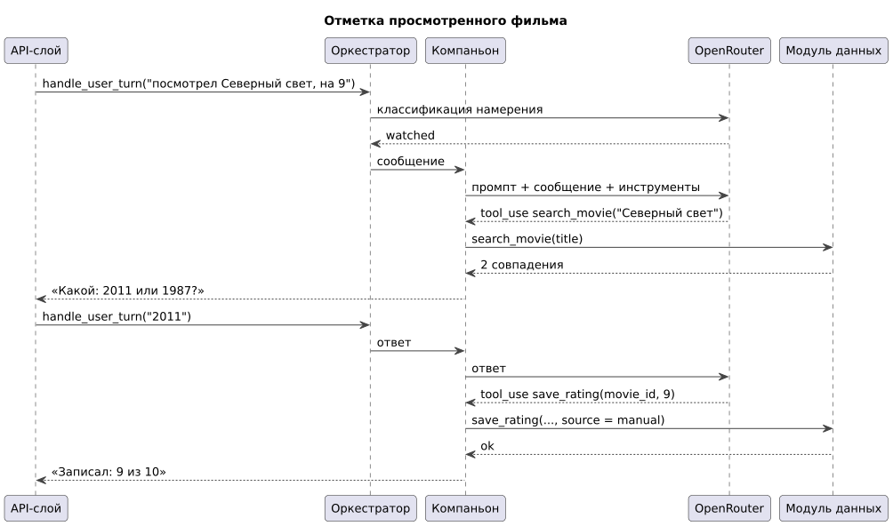

# 155 — Sequence-диаграммы

*CineMatch. Модуль ИИ-агентов* | [оглавление модуля](README.md)

Диаграммы показывают порядок вызовов; текст под каждой — нормативное описание того же сценария, чтобы документ читался без картинки. Тайм-ауты — [overall/config.md §2](../overall/config.md#2-тайм-ауты-и-целевые-значения).

## 1. Подбор фильма с вызовом инструментов (UC-3)

Участники: пользователь, API-слой, оркестратор, агент, реестр инструментов, модуль данных, RouterAI.

1. Пользователь пишет сообщение; API-слой вызывает `handle_user_turn` и открывает SSE-поток.
2. Оркестратор отправляет `progress(classify, …)`, загружает сессию и вызывает классификатор.
3. Классификатор вернул `cinema` — оркестратор подставляет `user_id`, `exclude_ids`, город и оценки и запускает агента.
4. Агент вызывает `extract_context`; оркестратор отправляет `progress(tool, «Разбираю, что вы описали…»)`.
5. Агент при необходимости вызывает `get_weather`, `get_user_ratings`, `get_user_profile` — на каждый вызов своё событие `tool`.
6. Агент вызывает `find_movies` с критериями по правилам [120 §2](120.data-model.md#2-правила-контекст--критерии-поиска); реестр подставляет `user_id` и `exclude_ids`.
7. Модуль данных возвращает карточки; агент выбирает до трёх и формирует `AgentOutput` с `movie_ids` и `reasons`.
8. Оркестратор отправляет `progress(check, …)`, проверяет ответ, склеивает карточки и возвращает `AgentResponse`.
9. API-слой отправляет `event: response` с телом `AgentResponse`; поток закрывается.

Альтернативы:

- Погода недоступна — `get_weather` вернул `None`, шаг 5 пропускается, в ответе нет упоминания погоды.
- `find_movies` вернул меньше трёх — агент ослабляет критерии ([120 §2.1](120.data-model.md#21-ослабление-критериев)); ноль — ответ без карточек.
- Модель не ответила за `LLM_TIMEOUT_S` — один повтор, затем `LLM_UNAVAILABLE`.
- Ход дольше `TURN_TIMEOUT_S` — `LIMIT_EXCEEDED` от оркестратора.
- Ответ не прошёл проверку — один повтор, затем `LLM_INVALID_OUTPUT`.

## 2. Выбор фильма и оценка при следующем визите (UC-4, UC-5)

1. Подборка показана; пользователь нажимает карточку — интерфейс отправляет сообщение «Выбираю «…»» с `movie_id`.
2. Оркестратор классифицирует сообщение как `cinema` и передаёт `movie_id` агенту как подсказку.
3. Агент вызывает `save_choice(movie_id)`; реестр проверяет, что фильм есть в `last_shown_ids`.
4. Модуль данных сохраняет выбор со статусом `pending` и возвращает `choice_id`.
5. Оркестратор сохраняет `pending` в сессию и отвечает `confirmation` с названием и годом.
6. При следующем открытии страницы API-слой отправляет `/start`; оркестратор видит `pending` и возвращает `feedback_question`.
7. Пользователь называет оценку и подошёл ли фильм под настроение; агент вызывает `save_rating`, выбор закрывается.
8. Ответ — `confirmation`: «Записал: «…» (год) — N из 10.»

Альтернативы:

- «Не смотрел» — `close_choice(status="dismissed")`, оценка не сохраняется.
- Пользователь сразу заговорил о другом — вопрос об оценке откладывается, `pending` остаётся.
- `save_choice` с фильмом не из последней подборки — `NOT_FOUND` модели, агент уточняет выбор.
- Оценка вне 1–10 — `INVALID_PARAM` модели, агент переспрашивает один раз.

## 3. Отметка просмотренного фильма (UC-6)

1. Пользователь пишет «вчера посмотрел северный свет, на 9».
2. Классификатор — `cinema`; агент вызывает `search_movie("северный свет")`.
3. Одно совпадение — `save_rating(movie_id, 9, source="manual")`; несколько — уточняющий вопрос с годами.
4. Оркестратор отвечает `confirmation` с названием и годом.
5. Фильм попадает в оценённые и больше не рекомендуется.

Альтернативы: не найдено — просьба уточнить название; оценка не названа — один вопрос об оценке; несколько совпадений без года — вопрос с вариантами.

## 4. Сценарии без диаграммы

Диаграммы для этих сценариев будут добавлены вместе с ближайшим экспортом SVG; текст ниже нормативен.

### 4.1. Открытие приложения и `/start`

1. `GET /api/v1/session` → `{consent, city, has_pending_feedback}`.
2. `POST /api/v1/messages {"text": "/start"}`.
3. Оркестратор обрабатывает `/start` без классификатора и модели, возвращает приветствие этапа ([146 §3](146.logic-scheme.md#3-служебное-сообщение-start)).
4. API-слой отдаёт `event: response`; в историю сообщение не попадает.

### 4.2. Согласие кнопкой и текстом

1. Кнопка «Принимаю» — `POST /api/v1/consent {"accepted": true}` → `set_consent(user_id, True)` → `AgentResponse` с просьбой назвать город.
2. Текст «принимаю» на этапе `consent` → локальный `parse_consent` вернул `yes` → та же функция; модель не вызывается.
3. «Не сейчас» или «нет» — правила показываются снова, ничего не сохраняется, модель не вызывается.

### 4.3. Пустой каталог

1. Первое сообщение с подбором: `find_movies` возвращает пустой список.
2. Агент пробует ослабления ([120 §2.1](120.data-model.md#21-ослабление-критериев)).
3. Если каталог пуст полностью, модуль данных возвращает `CATALOG_EMPTY`; оркестратор отвечает `error` с текстом из [contracts §6](../overall/contracts.md#6-ошибки).

### 4.4. Ошибка модели

1. Клиент модели не получил ответ за 20 с — один повтор.
2. Повтор не удался — `LLM_UNAVAILABLE`; поток SSE завершается событием `error`, ввод остаётся доступен.
3. Сессия и этап не теряются: следующее сообщение обрабатывается как обычно.

### 4.5. Два сообщения одновременно

1. API-слой принимает первое сообщение и помечает пользователя как занятого.
2. Второе сообщение до завершения первого получает `409 SESSION_BUSY` ([contracts §6](../overall/contracts.md#6-ошибки)).
3. После ответа блокировка снимается.

## 5. Будущий функционал

Диаграмма создания напоминания агентом-планировщиком.

---

[← 150 Component Diagram](150.component-diagram.md) | [Оглавление](README.md) | [160 Integration Plan →](160.integration-plan.md)
