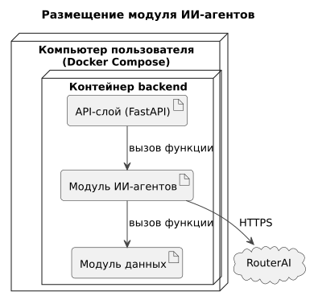

# 165 — Deployment Diagram

*CineMatch. Модуль ИИ-агентов* | [оглавление модуля](README.md)

Модуль агентов не развёртывается отдельно: он работает в контейнере backend вместе с API-слоем и модулем данных. Общая схема развёртывания — в [165 модуля интерфейса](../ui/165.deployment-diagram.md), структура и команды — в [build.md](../overall/build.md).

| Параметр | Значение |
|---|---|
| Конфигурация | `LLM_BASE_URL`, `LLM_API_KEY`, `LLM_MODEL`, `LLM_CLASSIFIER_MODEL`, `LLM_TIMEOUT_S`, `TURN_TIMEOUT_S` — из [config.md](../overall/config.md#1-переменные-окружения) |
| Сеть | исходящий HTTPS к `routerai.ru` (адрес из `LLM_BASE_URL`) |
| Ресурсы | минимальные: модель работает во внешнем сервисе; CPU ограничен разбором JSON и работой с SQLite |
| Проверка живости | `GET /api/v1/health` → `{"status": "ok", "catalog_size": N}` |
| Останов | при отсутствии обязательных переменных backend не стартует (`CONFIG_MISSING`); при недоступном RouterAI — работает и отвечает `LLM_UNAVAILABLE` |
| Секреты | только `.env`; в журнал и трассу не попадают (NFR-AG-08) |

Тайм-ауты (20 / 45 / 60 с) и условие их согласованности — [config.md §2](../overall/config.md#2-тайм-ауты-и-целевые-значения). Клиент модели создаётся с тайм-аутом `LLM_TIMEOUT_S` и одним повтором; оркестратор ограничивает ход `TURN_TIMEOUT_S`; API-слой ждёт `AGENT_TIMEOUT_S`.

### Будущий функционал

Режим локальной модели: отдельный контейнер с Ollama в той же конфигурации Docker Compose; меняется только `LLM_BASE_URL`. Переменной `LLM_MODE` в MVP нет.

---

[← 160 Integration Plan](160.integration-plan.md) | [Оглавление](README.md)
