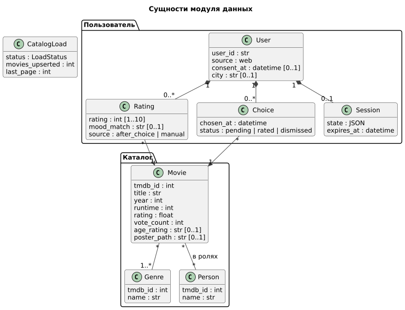
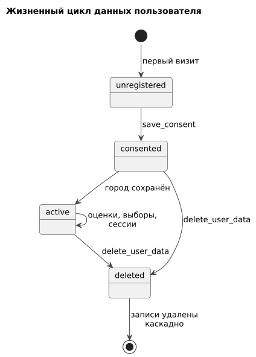
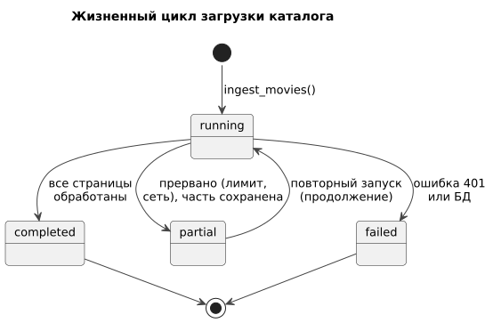

# 050 — Entities + Lifecycle

*CineMatch. Модуль данных* | [оглавление модуля](README.md)

## 1. Сущности

| Сущность | Таблица | Ключевые атрибуты | Ограничения | Кто пишет |
|---|---|---|---|---|
| Movie | `movies` | `tmdb_id`, `title`, `title_norm`, `original_title`, `year`, `runtime`, `rating`, `vote_count`, `popularity`, `age_rating`, `overview`, `poster_path`, `adult`, `updated_at` | `tmdb_id` уникален; `rating` 0–10; `runtime > 0`; `age_rating` из закрытого перечня; пишет только загрузка | скрипт загрузки |
| Genre | `genres` | `tmdb_id`, `name`, `name_norm` | `tmdb_id` и `name` уникальны; справочник TMDB на русском | скрипт загрузки |
| MovieGenre | `movie_genres` | `movie_id`, `genre_id` | пара уникальна; при обновлении фильма набор заменяется | скрипт загрузки |
| Person | `people` | `tmdb_id`, `name` | `tmdb_id` уникален | скрипт загрузки |
| CastMember | `movie_cast` | `movie_id`, `person_id`, `billing_order`, `character` | первые 10 актёров; `billing_order` 0–9 | скрипт загрузки |
| User | `users` | `user_id`, `source`, `consent_at`, `city`, `latitude`, `longitude`, `created_at` | `user_id` с префиксом источника: `web:local`; `source = web` | оркестратор, API-слой |
| Rating | `user_ratings` | `user_id`, `movie_id`, `rating`, `mood_match`, `source`, `rated_at` | одна на пару «пользователь — фильм»; `rating` 1–10 | инструменты агента |
| Choice | `user_choices` | `id`, `user_id`, `movie_id`, `status`, `chosen_at`, `closed_at` | не более одного `pending` на пользователя | инструменты агента |
| Session | `sessions` | `user_id`, `state_json`, `expires_at`, `updated_at` | одна на пользователя; удаляется через 24 ч без активности | оркестратор |
| CatalogLoad | `catalog_loads` | `id`, `started_at`, `finished_at`, `status`, `params_json`, `movies_upserted`, `movies_skipped`, `last_page` | статус из четырёх значений; журнал запусков | скрипт загрузки |

Столбцы, типы и DDL — [120](120.data-model.md#2-схема). Атрибуты карточки, которую видят другие модули, — [contracts §2.1](../overall/contracts.md#21-moviecard--карточка-фильма-из-каталога); в сущности Movie есть служебные поля (`title_norm`, `popularity`, `adult`, `updated_at`), которых в карточке нет.

## 2. Жизненный цикл данных пользователя

| Состояние | Описание | Переход |
|---|---|---|
| `unregistered` | Записи в `users` нет | Согласие → `consented` |
| `consented` | Есть `consent_at`, город не задан | Город сохранён → `active` |
| `active` | Полноценная работа: оценки, выборы, сессии | `delete_user_data` → `deleted` |
| `deleted` | Записи удалены каскадно | Следующий визит — снова `unregistered` |

Правила: согласие необратимо в пределах записи (снятие согласия = удаление данных); повторное согласие после удаления создаёт новую строку с новым `created_at`.

## 3. Жизненный цикл фильма в каталоге

| Состояние | Как возникает | Что меняется |
|---|---|---|
| Новый | `tmdb_id` нет в `movies` | `INSERT`, `updated_at = now` |
| Обновлён | `tmdb_id` есть | `UPDATE` полей и `updated_at`; `movies.id` не меняется |
| Пропущен | детали вернули 404 или нет `id`/названия | запись не создаётся, `movies_skipped += 1` |
| Выпал из TMDB | фильма больше нет в выдаче `discover` | запись остаётся: каталог не удаляет фильмы (ADR-012) |

Оценки и выборы ссылаются на `movies.id`, поэтому перезагрузка каталога не ломает историю пользователя.

## 4. Жизненный цикл выбора и оценки

| Статус `user_choices` | Как ставится | Что означает |
|---|---|---|
| `pending` | `save_choice` | фильм выбран, оценки ещё нет; не более одного на пользователя |
| `rated` | `save_rating` по фильму из `pending` | оценка сохранена, выбор закрыт |
| `dismissed` | `close_choice` («не смотрел») или новый `save_choice` | выбор закрыт без оценки |

Оценка без выбора (`manual`) создаёт только `user_ratings`; ожидающий выбор при этом не появляется.

## 5. Жизненный цикл загрузки каталога

| Статус | Переход |
|---|---|
| `running` | все страницы → `completed`; `Ctrl+C` или пятый неудачный повтор → `partial`; 401 или ошибка базы → `failed` |
| `partial` | повторный запуск с `--resume` продолжает с `last_page + 1` |
| `completed`, `failed` | терминальные; новый запуск создаёт новую запись |

## 6. Сроки хранения

| Данные | Срок |
|---|---|
| Каталог, жанры, актёры | бессрочно, обновляются загрузкой |
| Сессии | 24 часа без активности, затем `purge_expired` |
| Оценки, выборы, настройки | до удаления пользователем |
| Журнал загрузок | бессрочно |

### Будущий функционал

Сущности `Reminder`, `Subscription`; сериалы в каталоге; политика удаления фильмов, выпавших из TMDB.

---

[← 040 Event Storming](040.event-storming.md) | [Оглавление](README.md) | [060 Use Cases →](060.use-cases.md)
