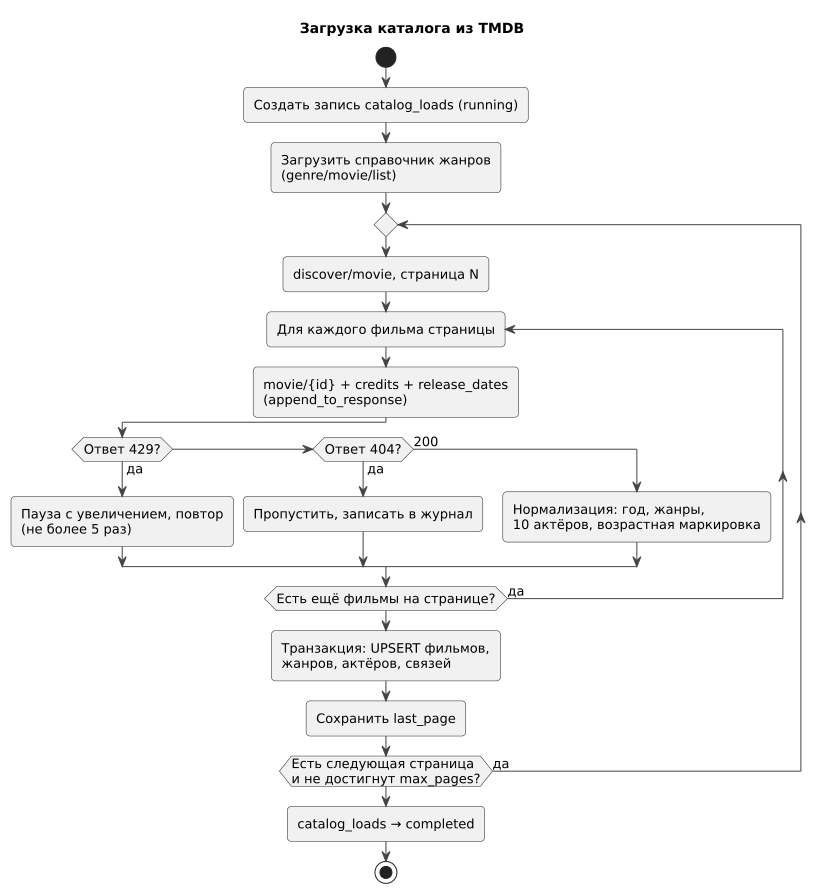
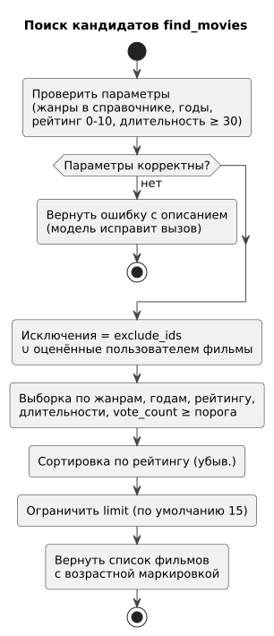

# 146 — Logic Scheme

*CineMatch. Модуль данных* | [оглавление модуля](README.md)

Схемы активности — ниже; под ними — текстовые алгоритмы, по которым пишется код. Схема таблиц — [120](120.data-model.md), сигнатуры и проверки — [130](130.api-contracts.md).

**Загрузка каталога**



**Поиск кандидатов**



## 1. Потоки данных

| Вызов | Инициатор | Частота | Транзакция |
|---|---|---|---|
| TMDB `discover`, `movie/{id}`, `genre/movie/list` | скрипт загрузки | только при загрузке каталога | страница (20 фильмов) |
| Open-Meteo Geocoding | `resolve_city` | при онбординге и смене города | нет |
| Open-Meteo Forecast | `get_weather` | каждый подбор, с кэшем 30 мин | нет |
| SQLite чтение | все функции чтения | каждый ход | нет (WAL) |
| SQLite запись | `save_*`, `delete_user_data`, сессии | по событию | одна на вызов |

Все вызовы синхронные. Постеры браузер загружает напрямую с `image.tmdb.org`: модуль отдаёт только `poster_url`, трафик изображений через backend не идёт.

## 2. Загрузка каталога (UC-9)

Вход: `pages`, `from_year`, `min_votes`, `resume` ([130 §4.19](130.api-contracts.md#419-ingest_movies)).

```
ingest_movies(pages, from_year, min_votes, resume):
    load = resume ? последняя запись catalog_loads
                     со status IN ('running','partial')
                     и теми же params_json
                  : None
    если load есть:
        start_page = load.last_page + 1
        load.status = running
    иначе:
        load = создать catalog_loads(status=running, last_page=0, params_json)
        start_page = 1

    жанры = GET /genre/movie/list?language=ru-RU
    upsert_genres(жанры)                       # одна транзакция

    batch = []
    для page от start_page до pages:
        ответ = GET /discover/movie(page=page, ...)   # §7.1 130
        если ответ.results пуст: прервать цикл         # страницы кончились
        для item в ответ.results:
            детали = GET /movie/{item.id}?append_to_response=credits,release_dates
            если детали = 404: skipped += 1; продолжить
            batch.append(нормализовать(item, детали))
        commit_batch(batch, last_page = page)          # порция = страница
        batch = []

    load.status = completed
    load.finished_at = now
    вернуть отчёт
```

```
commit_batch(batch, last_page):
    BEGIN
        для каждого фильма:
            movie = INSERT … ON CONFLICT(tmdb_id) DO UPDATE
            DELETE movie_genres WHERE movie_id = movie.id; INSERT жанры
            upsert people по tmdb_id
            DELETE movie_cast WHERE movie_id = movie.id; INSERT первые 10
        UPDATE catalog_loads SET last_page = last_page,
               movies_upserted = movies_upserted + N,
               movies_skipped = movies_skipped + K
    COMMIT
```

Правила:

1. `last_page` обновляется только после коммита: при падении процесса продолжение начинается с последней зафиксированной страницы, дублей не будет благодаря `tmdb_id UNIQUE`.
2. Прерывание `Ctrl+C` — исключение `KeyboardInterrupt` ловится в цикле страниц: текущая порция коммитится, `status = partial`, `finished_at = now`, отчёт, exit code 1.
3. 401 — `status = failed`, `finished_at = now`, `IngestError`, exit code 2. 429 и 5xx — повторы по [130 §7.4](130.api-contracts.md#74-ограничение-частоты-и-повторы); после пятого — `partial`, exit code 4.
4. Ошибка записи (диск, блокировка дольше 5 с) — `status = failed`, exit code 3; уже закоммиченные порции остаются в базе.
5. Загрузка не удаляет фильмы, выпавшие из TMDB: каталог только пополняется и обновляется.

## 3. Поиск кандидатов (`find_movies`)

```
find_movies(user_id, genres, year_from, year_to, min_rating, max_runtime, exclude_ids, limit):
    проверить параметры                          # таблица §4.4 130
    если genres заданы:
        для каждого названия:
            genre = SELECT id FROM genres WHERE name_norm = normalize(name)
            если нет: ToolError(UNKNOWN_GENRE, список допустимых)
    если SELECT 1 FROM movies LIMIT 1 пуст:
        ServiceError(CATALOG_EMPTY)

    sql = собрать запрос из §4.4 130 с подстановкой параметров
    rows = выполнить(sql)
    вернуть [movie_card(row) для row в rows]
```

Правила:

1. Порог `vote_count >= 100` и `rating IS NOT NULL` добавляются всегда, модель их не передаёт и не может отключить.
2. Оценённые пользователем фильмы исключаются подзапросом по `user_ratings`; `exclude_ids` — дополнительный список показанных в сессии.
3. Жанры — логика «И». Порядок `rating DESC, vote_count DESC, id ASC`.
4. `movie_card` собирает `poster_url` из `poster_path` и список жанров через `movie_genres` (порядок по `genres.tmdb_id`); второго запроса на карточку нет — жанры подтягиваются одним `JOIN`/предзагрузкой.
5. Результат — не больше `limit` карточек; пусто — `[]`.

## 4. Профиль предпочтений

```
get_user_profile(user_id):
    оценки = SELECT r.rating, m.id FROM user_ratings r JOIN movies m ON m.id = r.movie_id
             WHERE r.user_id = :user_id
    если оценки пусты: вернуть {genre_weights: {}, actor_weights: {}, ratings_count: 0}

    для каждой оценки: r = (rating − 5.5) / 4.5
    жанры: для каждого жанра фильма накопить сумму r и количество
    актёры: для каждого актёра из movie_cast фильма накопить сумму r и количество
    weight = round(sum / n × n / (n + 3), 3)
    вернуть словари, отсортированные по |weight| по убыванию, затем по названию
```

Формула и пример — [ADR-013](145.architecture-decisions.md#adr-013). Профиль считается по всем оценкам при каждом вызове; кэша нет — запрос дешёвый (NFR-DB-02).

## 5. Погода

```
get_weather(user_id):
    user = get_user(user_id)
    если user нет или user.city пуст: вернуть None
    key = (round(lat, 3), round(lon, 3))
    если key в кэше и возраст < 30 мин: вернуть кэш[key]
    ответ = GET forecast(lat, lon, current=temperature_2m,weather_code,is_day, timeout=3)
    если тайм-аут или ошибка: журнал weather_unavailable; вернуть None
    weather = {city: user.city, condition: WMO[code], temp_c: round(t,1), is_day: is_day=1}
    кэш[key] = weather
    вернуть weather
```

Коды WMO → `condition` и правила кэша — [130 §8](130.api-contracts.md#8-погода-и-геокодирование). Отказ сервиса никогда не превращается в ошибку пользователю: агент просто не упоминает погоду ([120 агентов §2](../agents/120.data-model.md#2-правила-контекст--критерии-поиска)).

## 6. Согласие, город, сессия

| Операция | Алгоритм |
|---|---|
| `save_consent` | `INSERT … ON CONFLICT(user_id) DO UPDATE SET source = :source` и `consent_at = COALESCE(consent_at, now)`; `created_at` не меняется |
| `resolve_city` | нормализовать запрос → кэш геокодирования (24 ч) → `GET search` → первые 5 → `[{name, region: admin1, country, latitude, longitude}]`; пусто — `[]` |
| `save_user_settings` | `UPDATE users SET city, latitude, longitude WHERE user_id`; 0 строк — `ValueError` |
| `get_session_state` | `SELECT` по `user_id`; `expires_at <= now` → `DELETE`, `None`; иначе `SessionState.model_validate_json`; ошибка разбора → `DELETE`, журнал, `None` |
| `save_session_state` | `INSERT … ON CONFLICT(user_id) DO UPDATE`, `expires_at = now + 24 ч` |
| `clear_session_state` | `DELETE FROM sessions WHERE user_id` |

## 7. Оценки и выборы

```
save_rating(user_id, movie_id, rating, source, mood_match):
    проверить rating 1…10, source, mood_match
    BEGIN
        upsert user_ratings по (user_id, movie_id)
        choice = SELECT id FROM user_choices
                 WHERE user_id = :user_id AND movie_id = :movie_id AND status = 'pending'
        если choice: UPDATE user_choices SET status='rated', closed_at=now WHERE id = choice.id
    COMMIT
    вернуть {saved: true, closed_choice_id: choice?.id}
```

```
save_choice(user_id, movie_id):
    проверить movie_id и наличие фильма
    BEGIN
        UPDATE user_choices SET status='dismissed', closed_at=now
         WHERE user_id = :user_id AND status = 'pending'
        INSERT user_choices(user_id, movie_id, 'pending', chosen_at=now)
    COMMIT
    вернуть {choice_id: last_insert_rowid()}
```

`close_choice` — `UPDATE … SET status='dismissed', closed_at=now WHERE id = :id AND status='pending'`; 0 строк — `NOT_FOUND`.

## 8. Удаление данных

```
delete_user_data(user_id):
    BEGIN
        counts = {
          user_ratings: COUNT WHERE user_id,
          user_choices: COUNT WHERE user_id,
          sessions:     COUNT WHERE user_id,
          users:        COUNT WHERE user_id,
        }
        DELETE FROM users WHERE user_id = :user_id     # каскад: оценки, выборы, сессия
    COMMIT
    вернуть {deleted_counts: counts}
```

Внешние ключи включены на соединении (ADR-016); без этого каскад не сработает. Каталог, жанры, актёры и журнал загрузок не затрагиваются.

### Будущий функционал

Периодическая проверка новинок — отдельный поток по расписанию; удаление устаревших записей каталога.

---

[← 145 ADR](145.architecture-decisions.md) | [Оглавление](README.md) | [150 Component Diagram →](150.component-diagram.md)
