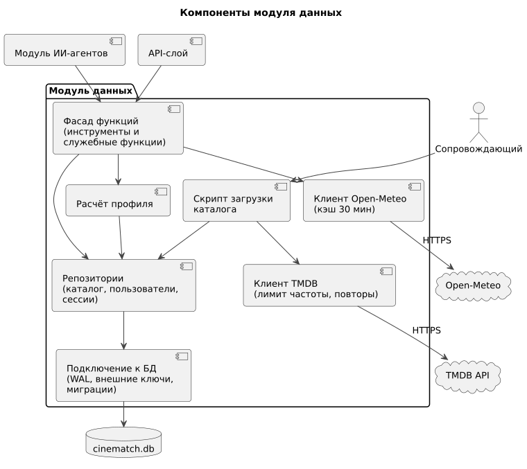

# 150 — Component Diagram

*CineMatch. Модуль данных* | [оглавление модуля](README.md)

| Компонент | Файл | Технология | Ответственность |
|---|---|---|---|
| Подключение к БД | `cinematch/data/db.py` | SQLAlchemy 2.0, Alembic | движок, `PRAGMA` (WAL, внешние ключи, `busy_timeout`), сессии, `alembic upgrade head` ([120 §1](120.data-model.md#1-файл-базы-и-параметры-подключения), ADR-011) |
| Модели | `cinematch/data/models.py` | SQLAlchemy ORM | таблицы, ограничения, индексы, нормализация строк ([120 §2](120.data-model.md#2-схема)) |
| Репозитории | `cinematch/data/repositories/` | SQLAlchemy Core | запросы по группам: каталог, пользователи, оценки, выборы, сессии, загрузки |
| Фасад функций | `cinematch/data/api.py` | Python | 9 инструментов и 12 служебных функций, проверка параметров, `ToolError`/`ServiceError` ([130 §3–4](130.api-contracts.md#3-инструменты-агента)) |
| Расчёт профиля | `cinematch/data/services/profile.py` | Python | веса жанров и актёров при чтении ([ADR-013](145.architecture-decisions.md#adr-013)) |
| Клиент TMDB | `cinematch/data/clients/tmdb.py` | Python, `httpx` | запросы, темп 40/с, повторы, нормализация ответа ([130 §7](130.api-contracts.md#7-загрузка-каталога)) |
| Клиент Open-Meteo | `cinematch/data/clients/weather.py` | Python, `httpx` | геокодирование, погода, коды WMO, кэш, тайм-аут 3 с ([130 §8](130.api-contracts.md#8-погода-и-геокодирование)) |
| Скрипт загрузки | `scripts/load_catalog.py` | Python, `argparse` | UC-9, отчёт, коды завершения ([110](110.ui-ux.md)) |
| Миграции | `migrations/` | Alembic | история схемы, откат ([120 §9](120.data-model.md#9-миграции)) |

## 1. Правила компонентов

1. SQL живёт только в `repositories/` и `db.py`; `api.py` вызывает репозитории и не строит запросы.
2. Клиенты внешних систем — только в модуле данных. Другие модули не обращаются к TMDB и Open-Meteo ([020](020.system-context.md)).
3. `api.py` — единственная точка входа: функции этого файла импортирует модуль агентов и API-слой. Репозитории наружу не экспортируются.
4. Проверка параметров — в `api.py` до вызова репозитория; репозитории получают уже проверенные значения (ADR-015).
5. Транзакция открывается в `api.py` (одна на функцию записи) и передаётся в репозитории параметром сессии.
6. Клиенты не знают о базе: TMDB отдаёт нормализованные словари, запись выполняет репозиторий каталога.
7. `scripts/load_catalog.py` — тонкая обёртка: разбор аргументов, вызов `ingest_movies`, печать отчёта, коды завершения. Логики загрузки в скрипте нет.

## 2. Порядок инициализации

1. `config.py` читает `TMDB_API_KEY`, `CINEMATCH_DB_PATH` ([config.md](../overall/config.md)).
2. `db.py` создаёт движок и включает `PRAGMA`.
3. `alembic upgrade head` — схема готова.
4. `purge_expired()` — очистка сессий.
5. Регистрация инструментов агента — реестр получает ссылки на функции `api.py`.

### Будущий функционал

Компонент «Проверка новинок» (планировщик), репозиторий сериалов.

---

[← 146 Logic Scheme](146.logic-scheme.md) | [Оглавление](README.md) | [155 Sequence-диаграммы →](155.sequence-diagrams.md)
