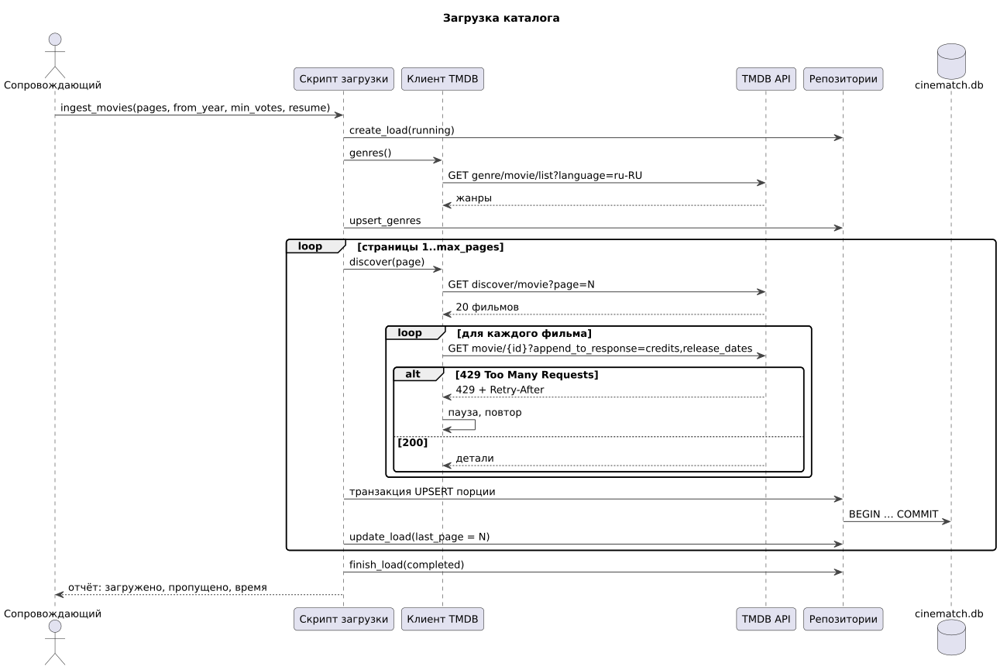
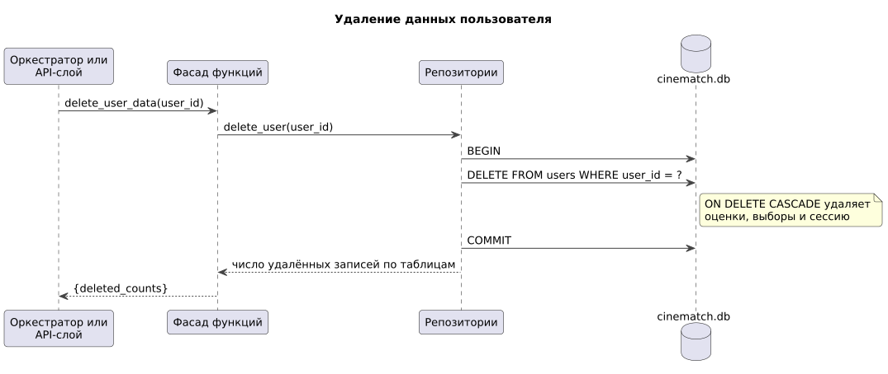

# 155 — Sequence-диаграммы

*CineMatch. Модуль данных* | [оглавление модуля](README.md)

**Загрузка каталога** (UC-9). Таймаут запроса к TMDB — 10 с; при 429 — пауза по `Retry-After` или 1, 2, 4… с, до 5 повторов.

**Удаление данных пользователя** (UC-7).

Поиск кандидатов в составе подбора — в [155 модуля агентов](../agents/155.sequence-diagrams.md).

## 1. Разбор «Загрузка каталога»

| Шаг | Отправитель → получатель | Сообщение | Что происходит |
|---|---|---|---|
| 1 | Сопровождающий → Скрипт | `ingest_movies(pages, from_year, min_votes, resume)` | разбор аргументов, проверка ключа |
| 2 | Скрипт → Репозиторий загрузок | `create_load(running)` или поиск незавершённой | `load_id`, `start_page` |
| 3 | Скрипт → Клиент TMDB | `GET /genre/movie/list` | справочник жанров |
| 4 | Скрипт → Репозиторий каталога | `upsert_genres` | одна транзакция |
| 5 | Скрипт → Клиент TMDB | `GET /discover/movie?page=N` | до 20 фильмов |
| 6 | Скрипт → Клиент TMDB | `GET /movie/{id}?append_to_response=credits,release_dates` | по одному на фильм |
| 7 | Скрипт → Репозиторий каталога | `commit_batch(страница, last_page)` | `BEGIN … COMMIT`, `movies`, `movie_genres`, `people`, `movie_cast` |
| 8 | Скрипт → Репозиторий загрузок | `update_load(last_page, счётчики)` | после коммита |
| 9 | Скрипт → Сопровождающий | отчёт | `load_id`, `pages`, `upserted`, `skipped`, время |

## 2. Разбор «Удаление данных»

| Шаг | Отправитель → получатель | Сообщение | Что происходит |
|---|---|---|---|
| 1 | Оркестратор или API-слой → Фасад | `delete_user_data(user_id)` | открывается транзакция |
| 2 | Фасад → Репозиторий пользователей | `count_user_rows(user_id)` | четыре `COUNT` |
| 3 | Фасад → Репозиторий пользователей | `DELETE FROM users` | каскад: `user_ratings`, `user_choices`, `sessions` |
| 4 | Репозиторий → SQLite | `COMMIT` | удаление зафиксировано |
| 5 | Фасад → отправитель | `{deleted_counts}` | отчёт API-слою |

Каталог, жанры, актёры и `catalog_loads` в транзакции не участвуют.

## 3. Сценарии без диаграмм

**Поиск кандидатов.** Агент → реестр инструментов → `find_movies` → проверка параметров → `ServiceError(CATALOG_EMPTY)` или SQL → сборка карточек → список агенту. Второго запроса на жанры нет: они подтягиваются вместе с фильмами. Оценённые фильмы исключены подзапросом; `exclude_ids` — из `shown_ids` сессии; запрещённые жанры — `exclude_genres`.

**Погода.** Агент → реестр инструментов → `get_weather` → `get_user` → кэш по координатам → при промахе `GET forecast` → `Weather` или `None`. Отказ сети не прерывает ход: агент получает `None` и не упоминает погоду.

**Выбор города.** API-слой (`GET /cities?query=…`) или оркестратор → `resolve_city` → кэш геокодирования → `GET search` → до 5 вариантов. Пусто → `CITY_NOT_FOUND`. Сохранение — `save_user_settings`.

**Продолжение загрузки.** Сопровождающий → `load_catalog --resume` → поиск `catalog_loads` со `status IN ('running','partial')` и теми же параметрами → `start_page = last_page + 1` → цикл страниц. Если подходящей записи нет — новый запуск с первой страницы.

**Ошибки TMDB.** 404 на детали → фильм пропускается, счётчик `skipped`, цикл продолжается. 429 → пауза по `Retry-After`, повтор того же запроса, до 5 раз. 401 → `status = failed`, `IngestError`, exit code 2. Пять неудач подряд → `status = partial`, exit code 4, продолжение возможно через `--resume`.

### Будущий функционал

Диаграмма проверки новинок; последовательность уведомлений.

---

[← 150 Component Diagram](150.component-diagram.md) | [Оглавление](README.md) | [160 Integration Plan →](160.integration-plan.md)
