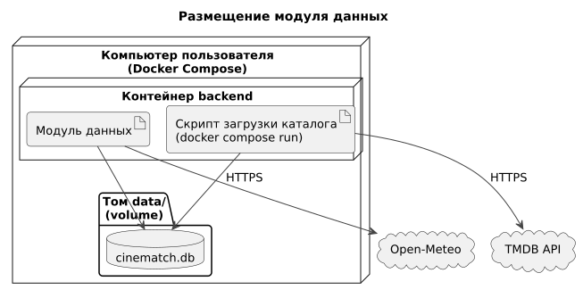

# 165 — Deployment Diagram

*CineMatch. Модуль данных* | [оглавление модуля](README.md)

## 1. Размещение

| Параметр | Значение |
|---|---|
| Процесс | тот же контейнер `backend`, что FastAPI и модуль агентов; отдельного сервиса у модуля нет |
| Файл базы | `/data/cinematch.db` в томе `data`; локально — `storage/cinematch.db` ([config.md](../overall/config.md#1-переменные-окружения)) |
| Том | `data` монтируется только в `backend`; frontend и nginx файла не видят |
| Сеть | исходящий HTTPS к `api.themoviedb.org`, `api.open-meteo.com`, `geocoding-api.open-meteo.com`; входящих портов нет |
| Порты | SQLite не слушает порт: доступ только через файл |
| Диск | ≤ 100 МБ при 10 000 фильмов, ≤ 1 ГБ при 100 000 (NFR-DB-16) |
| Память | кэш погоды и геокодирования — до 1 000 + 500 записей, десятки килобайт |
| Пользователь контейнера | непривилегированный; файл базы принадлежит ему, права `0640` |

## 2. Переменные

`TMDB_API_KEY` (обязательна), `CINEMATCH_DB_PATH` (по умолчанию путь из таблицы). Полный список, значения по умолчанию и поведение при отсутствии — [config.md](../overall/config.md); здесь не дублируются.

## 3. Запуск и миграции

1. `alembic upgrade head` выполняется при старте backend до первого запроса ([build.md §3](../overall/build.md#3-порядок-старта-backend)).
2. Загрузка каталога: `docker compose run --rm backend python -m scripts.load_catalog` — отдельный процесс, тот же том и те же переменные.
3. При пустом каталоге backend стартует: `/api/v1/health` → `{"status": "ok", "catalog_size": 0}`, подбор → `CATALOG_EMPTY`.
4. Параллельная работа backend и загрузки разрешена (WAL, `busy_timeout` 5 с); загрузка не блокирует чтение дольше одной транзакции порции.

## 4. Резервное копирование

| Способ | Как |
|---|---|
| Полная копия | остановить backend и загрузку, скопировать `cinematch.db` вместе с `-wal` и `-shm` |
| Без остановки | `sqlite3 cinematch.db ".backup /data/backup.db"` — согласованный снимок |
| Восстановление | положить файл на место тома, запустить backend: миграции догонят схему |

Каталог восстанавливается и повторной загрузкой из TMDB; пользовательские данные — только из копии.

## 5. Наблюдаемость

| Что | Где |
|---|---|
| Журнал событий | stdout контейнера, структурный JSON ([140](140.event-schema.md)) |
| Ошибки доступа к базе | `event=error`, `code=DATA_UNAVAILABLE`, `layer=data` |
| Размер каталога | `/api/v1/health` → `catalog_size` |
| Состояние загрузки | `catalog_loads`; отчёт скрипта |

Общая схема контейнеров — в [165 модуля интерфейса](../ui/165.deployment-diagram.md).

### Будущий функционал

Резервное копирование по расписанию и PostgreSQL при развёртывании на сервере.

---

[← 160 Integration Plan](160.integration-plan.md) | [Оглавление](README.md)
