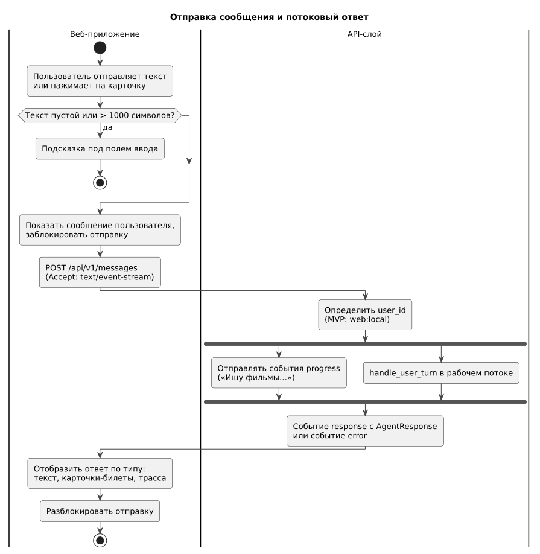

# 146 — Logic Scheme

*CineMatch. Модуль интерфейса* | [оглавление модуля](README.md)

**Потоки данных.** Браузер → nginx → API-слой → модуль агентов: синхронно для одного сообщения, с промежуточными событиями хода работы. История, настройки и удаление — прямые запросы к модулю данных через API-слой. Постеры — браузер напрямую с `image.tmdb.org`.

## 1. Сообщение и поток

1. `POST /api/v1/messages` принимает `{text, movie_id?}`.
2. API-слой проверяет длину, `SESSION_BUSY` и `catalog_size`; при ошибке отвечает HTTP-кодом до открытия SSE.
3. API-слой вызывает `handle_user_turn(user_id, text, movie_id, on_progress)`.
4. `on_progress(step, text)` кладёт в очередь событие `progress`; API-слой отдаёт его как `event: progress`.
5. Итог — `AgentResponse` в `event: response`; ошибка — `event: error` с кодом и текстом из `contracts §6`.
6. Поток закрывается; ввод снова доступен.

## 2. Согласие

1. `POST /api/v1/consent {"accepted": true}` → `set_consent(user_id, True)` → `AgentResponse` с просьбой назвать город.
2. `{"accepted": false}` → правила показываются снова, данные не сохраняются.
3. Текст «принимаю» на этапе `consent` разбирает оркестратор локально; API-слой не вызывает модель.

## 3. История, город, удаление

1. `GET /api/v1/history?limit=50` → `{items: HistoryItem[]}` из `data/130 §4.16`; пусто — приглашение подобрать фильм.
2. `GET /api/v1/cities?query=…` → варианты; `PUT /api/v1/settings` сохраняет `city`, `latitude`, `longitude`.
3. `DELETE /api/v1/me` → `{deleted_counts}`; после удаления приложение начинает с `consent`.

### Будущий функционал

Поток уведомлений от сервера к пользователю.

---

[← 145 ADR](145.architecture-decisions.md) | [Оглавление](README.md) | [150 Component Diagram →](150.component-diagram.md)
