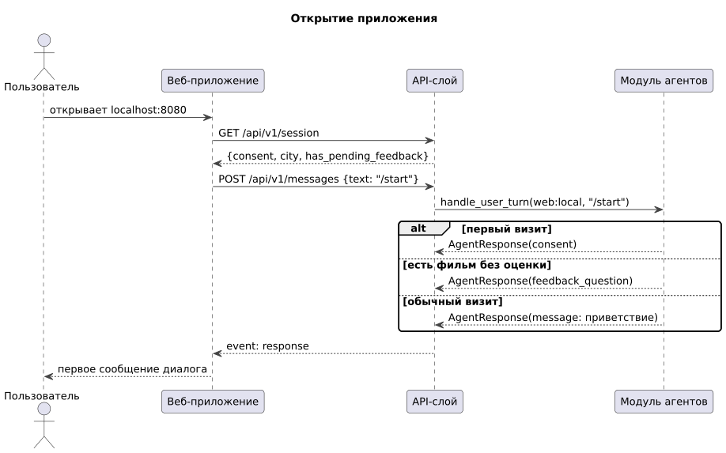
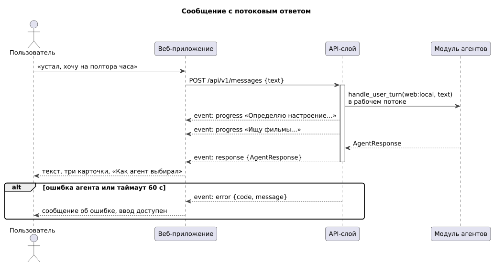
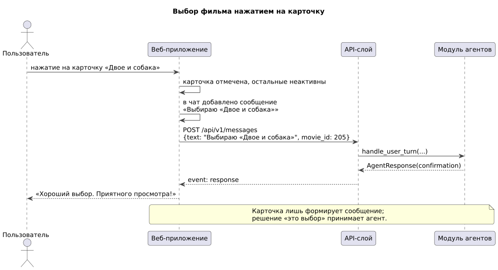

# 155 — Sequence-диаграммы

*CineMatch. Модуль интерфейса* | [оглавление модуля](README.md)

Диаграммы показывают порядок вызовов; текст под каждой — нормативное описание того же сценария, чтобы документ читался без картинки. Тайм-аут ответа — `AGENT_TIMEOUT_S` = 60 с ([config §2](../overall/config.md#2-тайм-ауты-и-целевые-значения)).

## 1. Открытие приложения (UC-1, UC-5)

1. Браузер загружает статику через nginx; API-слой вызывает `GET /api/v1/session`.
2. Ответ: `{consent, city, has_pending_feedback}`; `CurrentUser` подставляет `web:local`.
3. API-слой отправляет `POST /api/v1/messages {"text": "/start"}`.
4. Оркестратор обрабатывает `/start` до классификатора и модели; возвращает приветствие этапа: `consent`, `question` (город), `message` (диалог) или `feedback_question` при неоценённом выборе.
5. API-слой отдаёт `event: response` с `AgentResponse`; в историю сообщение не попадает.

## 2. Сообщение с потоковым ответом (UC-3)

1. Пользователь отправляет текст; веб-приложение блокирует ввод и открывает `POST /api/v1/messages`.
2. API-слой проверяет текст (пусто, > 1000) и занятость пользователя; при занятости — `409 SESSION_BUSY` без открытия SSE.
3. Оркестратор отправляет первое `progress` с `step="classify"` не позже 1 с; классификатор возвращает класс.
4. Для `cinema` оркестратор проверяет `get_catalog_size()`, затем запускает агента; инструменты дают `progress` с `step="tool"` и фразами из `agents/110 §4`.
5. После ответа модели — `progress` с `step="check"`; проверка ответа и сборка `AgentResponse`.
6. API-слой отправляет `event: response` и закрывает поток. При ошибке — `event: error` с кодом из `contracts §6`, ввод снова доступен.

## 3. Выбор фильма карточкой (UC-4)

1. Пользователь нажимает карточку; веб-приложение добавляет в ленту сообщение «Выбираю «…»» и отправляет его с `movie_id`.
2. API-слой вызывает `handle_user_turn`; оркестратор классифицирует сообщение как `cinema` и передаёт `movie_id` агенту как подсказку.
3. Агент вызывает `save_choice(movie_id)`; реестр проверяет, что фильм входит в `last_shown_ids` последней подборки.
4. Ответ — `confirmation` с названием и годом; выбранная карточка отмечена, остальные неактивны.
5. При следующем `/start` с `pending` — `feedback_question`; оценка закрывает выбор.

### Будущий функционал

Доставка уведомления Telegram-ботом.

---

[← 150 Component Diagram](150.component-diagram.md) | [Оглавление](README.md) | [160 Integration Plan →](160.integration-plan.md)
